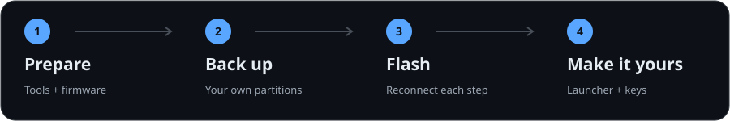

<div align="center">


# LX04 Flashing Guide

**Give your XiaoAI touchscreen speaker a new life as a tiny Android display.**

LX04 → X04G · Back up, flash, add a launcher and navigation — step by step.

[](#before-you-start)
[](#1-prepare-tools-and-files)
[](#the-route)

**English** · [简体中文](README.zh-CN.md)

</div>

---

## The route

<p align="center"></p>

Based on a successful conversion of a Chinese **LX04** to **X04G (Android Go 10)**. Use a Windows PC and run all commands in **Command Prompt (cmd)**, one at a time. The finished device can run ordinary Android APKs.

> [!WARNING]
> Flashing erases device data and can leave the device unable to boot. Back up your own device first, especially `proinfo.bin` and `nvram.bin`. Never use another device's backup or relock the bootloader.

## Before you start

- Check the label: this guide is for **LX04**, not other XiaoAI models.
- Prepare a physical Windows PC, a Micro-USB **data** cable and a stable **5V / 2A power supply**.
- Allow at least **15 GB** of PC storage, plus a second location for your backup.
- Use `D:\lx04` and `D:\platform-tools` below. If you have no D: drive, replace the drive letter consistently. Avoid spaces and non-ASCII characters in paths.
- This repository contains the guide. Download firmware, drivers and APKs from the sources below.

## 1. Prepare tools and files

| Tool or file | Source | Destination / action |
|---|---|---|
| Python 3.12, Git, 7-Zip | [Python](https://www.python.org/downloads/windows/) · [Git](https://git-scm.com/downloads/win) · [7-Zip](https://www.7-zip.org/) | Select **Add python.exe to PATH** during Python installation |
| mtkclient | [bkerler/mtkclient](https://github.com/bkerler/mtkclient) | Install with the commands below |
| UsbDk x64 | [Official releases](https://github.com/daynix/UsbDk/releases) | The original setup used `UsbDk_1.0.22_x64.msi`; restart the PC after installation |
| `xiaomi-x04g-lx04-main.zip` | [AyraHikari/xiaomi-x04g-lx04](https://github.com/AyraHikari/xiaomi-x04g-lx04) → Code → Download ZIP | Extract into `D:\lx04\repo\` |
| `dump_mico_x04g.tar.xz` | [X04G firmware archive](https://archive.org/details/dump_mico_x04g) | Extract twice with 7-Zip; place partition `.bin` files directly in `D:\lx04\global\` |
| SDK Platform-Tools | [Android downloads](https://developer.android.com/tools/releases/platform-tools) | Extract so `adb.exe` is at `D:\platform-tools\adb.exe` |
| KISS Launcher APK | [F-Droid](https://f-droid.org/packages/fr.neamar.kiss/) | Click **Download APK**; save as `D:\lx04\apps\KISS.apk` |
| Simple Keyboard APK | [F-Droid](https://f-droid.org/packages/rkr.simplekeyboard.inputmethod/) | Save as `D:\lx04\apps\SimpleKeyboard.apk` |
| VirtualSoftKeys APK | [F-Droid](https://f-droid.org/en/packages/tw.com.daxia.virtualsoftkeys/) | Download `0.2.0.180212.1 (10)`; save as `D:\lx04\apps\VirtualSoftKeys.apk` |

The APK names are conventions used in this guide: rename the downloads accordingly. You do not need the F-Droid client. Choose Android 10 compatible APKs; check the device ABI in step 4 when an APK includes native libraries.

Create the folders and install mtkclient in cmd:

```cmd
mkdir D:\lx04\backup\partitions D:\lx04\global D:\lx04\repo D:\lx04\tools D:\lx04\apps
cd /d D:\lx04
git clone https://github.com/bkerler/mtkclient
cd /d D:\lx04\mtkclient
git checkout cd25cf9c1ff6d36e82697ac2c798e69e9cfb78c3
python -m pip install -r requirements.txt
python -m pip install .
```

This pins the mtkclient commit used in the successful local setup, avoiding changes in newer commands. If installation requires Visual C++, install [Build Tools](https://visualstudio.microsoft.com/visual-cpp-build-tools/) with **Desktop development with C++**, then retry.

Extract `repo\xiaomi-x04g-lx04-main\files\FlashTool.7z` into `D:\lx04\tools\`. Locate `driver\Mediatek-Drivers-Install.bat` and run it as administrator to install MTK VCOM drivers. **All flashing below uses mtkclient.**

Check the layout:

```text
D:\lx04\
├── mtkclient\mtk.py
├── backup\partitions\              ← your own backup, created next
├── global\                         ← firmware partitions, no extra nesting
│   ├── gpt.bin
│   ├── boot.bin
│   ├── super.bin
│   └── ...                         ← remaining partition .bin files
├── repo\xiaomi-x04g-lx04-main\files\
│   ├── gpt_x04g.bin
│   ├── preloader_mico_x04g.bin
│   ├── boot1_for_microx04g.bin
│   └── boot_global_magisk.bin
└── apps\
    ├── KISS.apk
    ├── SimpleKeyboard.apk
    └── VirtualSoftKeys.apk

D:\platform-tools\adb.exe
```

Use the archive's `sha256sums.txt` to verify partition files. For example, run `certutil -hashfile D:\lx04\global\super.bin SHA256` and compare it with the corresponding line. Do not mix other firmware, your backups or APKs into `global`: `wl` scans it recursively.

## 2. Connect and back up your device

### Reconnect for every mtkclient command

1. Disconnect the device USB cable. Wait at least **5 seconds**, until the screen is completely black.
2. **Run the PC command first.** Wait for `Waiting for PreLoader VCOM`.
3. Hold **Volume Up** on the device while connecting it to the PC by USB.
4. Release when the handshake starts and output scrolls. If reconnection is requested, hold Volume Up and reconnect once more.
5. Wait for completion. Repeat the sequence for the next command.

A successful handshake includes `Device detected`, `Kamakiri Run` and `Boot to succeeded`. If you get `Wrong magic`, press `Ctrl+C`, disconnect and start the sequence again.

First, test the connection by reading the partition table:

```cmd
cd /d D:\lx04\mtkclient
python mtk.py printgpt --noreconnect
```

Back up every partition and both boot regions. Reconnect separately for each command:

```cmd
python mtk.py rl D:\lx04\backup\partitions --noreconnect
```

```cmd
python mtk.py r preloader D:\lx04\backup\preloader_boot1.bin --parttype=boot1 --noreconnect
```

```cmd
python mtk.py r preloader D:\lx04\backup\preloader_boot2.bin --parttype=boot2 --noreconnect
```

The partition backup may take about two hours. Check for read failures and confirm these files exist and are nonempty. Sizes from the original device:

| Your backup | Reference size | Purpose |
|---|---:|---|
| `backup\partitions\proinfo.bin` | 3 MiB | Device serial information |
| `backup\partitions\nvram.bin` | 5 MiB | Wi-Fi / Bluetooth identifiers and calibration |
| `backup\partitions\protect1.bin`, `protect2.bin` | 10 MiB each | Original device data |
| `backup\preloader_boot1.bin`, `preloader_boot2.bin` | 2 MiB each | Original boot regions |

**Copy the entire `backup` folder to a second location before continuing.** Do not flash without `proinfo` and `nvram`. Backups contain unique device information: keep them private.

## 3. Flash X04G

Run in `D:\lx04\mtkclient`, in this order. **Repeat the step 2 connection sequence for every command.** Stop and investigate any actual partition write failure before continuing.

**① Write the X04G partition table** — `gpt_x04g.bin`

```cmd
python mtk.py wf D:\lx04\repo\xiaomi-x04g-lx04-main\files\gpt_x04g.bin --noreconnect
```

**② Write the X04G firmware partitions** — the `global` directory. This takes a while.

```cmd
python mtk.py wl D:\lx04\global --preloader D:\lx04\repo\xiaomi-x04g-lx04-main\files\preloader_mico_x04g.bin --noreconnect
```

Non-partition archive items such as `.state`, checksum files or `full_flash` may be skipped with a partition-not-found message. This differs from a failed write to an actual system partition such as `boot` or `super`. Check that system partitions were written successfully.

**③ Write the boot1 region** — `boot1_for_microx04g.bin`

```cmd
python mtk.py w preloader D:\lx04\repo\xiaomi-x04g-lx04-main\files\boot1_for_microx04g.bin --parttype=boot1 --preloader D:\lx04\repo\xiaomi-x04g-lx04-main\files\preloader_mico_x04g.bin --noreconnect
```

**④ Erase old user data, cache and the firmware's device information**

```cmd
python mtk.py e userdata,cache,proinfo --noreconnect
```

**⑤ Restore your own device information** — `proinfo.bin` from step 2

```cmd
python mtk.py w proinfo D:\lx04\backup\partitions\proinfo.bin --noreconnect
```

**⑥ Erase nvdata**

```cmd
python mtk.py e nvdata --noreconnect
```

**⑦ Restore your own nvram** — `nvram.bin` from step 2

```cmd
python mtk.py w nvram D:\lx04\backup\partitions\nvram.bin --noreconnect
```

**⑧ Unlock the bootloader** — do this after writing the firmware.

```cmd
python mtk.py da seccfg unlock --noreconnect
```

**⑨ Reset**

```cmd
python mtk.py reset --noreconnect
```

After reset completes, unplug USB and boot from a **5V / 2A power supply**. Allow **10–15 minutes** for the first boot. **Orange State** is normal with an unlocked bootloader.

If Android Recovery reports that it cannot load the system, select **Wipe data/factory reset → Yes → Reboot system now**. Use the volume buttons to move and the mute button to confirm, then wait for boot again.

## 4. Enable ADB root

Once X04G boots successfully, flash the Magisk-patched boot with mtkclient. Reconnect separately for both commands:

```cmd
python mtk.py w boot D:\lx04\repo\xiaomi-x04g-lx04-main\files\boot_global_magisk.bin --noreconnect
```

```cmd
python mtk.py reset --noreconnect
```

After boot, connect the data cable to the PC and run:

```cmd
cd /d D:\platform-tools
adb devices
adb shell id
adb shell getprop ro.product.cpu.abilist
```

The device should appear as `device`, and `id` should include `uid=0(root)`. Disconnect other Android devices if more than one is attached. In the original setup this boot provides **ADB root**, but the Magisk daemon is unavailable, so apps cannot request root through Magisk. Run the following commands directly, without `su -c`.

## 5. Install keyboard, launcher and navigation

Run these commands from `D:\platform-tools`.

### Keyboard: Simple Keyboard

The stock system lacks a usable keyboard. Install one first for Wi-Fi passwords and other input:

```cmd
adb install D:\lx04\apps\SimpleKeyboard.apk
adb shell ime enable rkr.simplekeyboard.inputmethod/.latin.LatinIME
adb shell ime set rkr.simplekeyboard.inputmethod/.latin.LatinIME
```

### Home screen: KISS Launcher

```cmd
adb install D:\lx04\apps\KISS.apk
adb shell monkey -p fr.neamar.kiss -c android.intent.category.LAUNCHER 1
adb shell am start -a android.settings.HOME_SETTINGS
```

Choose **KISS Launcher** as the default home app. If a home-app chooser appears, select KISS and **Always**. Check that Home returns to KISS:

```cmd
adb shell input keyevent 3
```

If KISS is absent from the home settings, resolve its HOME component first:

```cmd
adb shell cmd package resolve-activity --brief -a android.intent.action.MAIN -c android.intent.category.HOME -p fr.neamar.kiss
```

Copy the final `fr.neamar.kiss/...` component from the output and substitute it for `HOME_COMPONENT`:

```cmd
adb shell cmd package set-home-activity HOME_COMPONENT
adb shell input keyevent 3
```

Once KISS works, disable the original clock interface and setup prompts:

```cmd
adb shell pm disable-user --user 0 com.google.android.apps.mediashell
adb shell settings put global device_provisioned 1
adb shell settings put secure user_setup_complete 1
```

To restore the original interface: `adb shell pm enable com.google.android.apps.mediashell`.

### Navigation: VirtualSoftKeys

The system has no conventional Back / Home navigation bar. Add floating navigation:

```cmd
adb install D:\lx04\apps\VirtualSoftKeys.apk
adb shell appops set tw.com.daxia.virtualsoftkeys SYSTEM_ALERT_WINDOW allow
adb shell am start -a android.settings.ACCESSIBILITY_SETTINGS
```

Enable the **VirtualSoftKeys** accessibility service, open the app and complete its prompts. Swipe up from the bottom edge to reveal the navigation bar. If the settings page is difficult to use, enable the service with these commands (they replace the existing accessibility-service list; suitable for a freshly flashed device):

```cmd
adb shell settings put secure enabled_accessibility_services tw.com.daxia.virtualsoftkeys/tw.com.daxia.virtualsoftkeys.service.ServiceFloating
adb shell settings put secure accessibility_enabled 1
adb shell monkey -p tw.com.daxia.virtualsoftkeys -c android.intent.category.LAUNCHER 1
```

**Navigation may stop working after a reboot.** Re-enable the service and reopen the app, or rerun the three commands above. Temporary controls: `adb shell input keyevent 4` for Back and `adb shell input keyevent 3` for Home.

## 6. Wi-Fi, wireless ADB and display

### Connect to Wi-Fi

```cmd
adb shell am start -a android.settings.WIFI_SETTINGS
```

Select your network on the screen and enter its password with the keyboard. Find the assigned IP:

```cmd
adb shell ip addr show wlan0
```

### Enable wireless ADB

While connected by USB, run these commands. The second one disconnects the ADB session:

```cmd
adb shell setprop persist.adb.tcp.port 5555
adb shell setprop ctl.restart adbd
```

Move the device back to its stable power supply. Keep the PC on the same LAN and replace `DEVICE_IP` with the device's actual IP:

```cmd
adb connect DEVICE_IP:5555
adb devices
```

The setting survives reboot. Wireless ADB on this image exposes root access to the LAN: use a trusted network and do not forward port 5555 to the internet. To turn it off:

```cmd
adb shell setprop persist.adb.tcp.port -1
adb shell setprop ctl.restart adbd
```

### Resolution, density and orientation

The physical screen is **800 × 480**. Query settings first; **lower density fits more content on screen** and is usually the first adjustment to try.

```cmd
adb shell wm size
adb shell wm density
adb shell wm density 140
adb shell settings put system accelerometer_rotation 0
adb shell settings put system user_rotation 0
```

To set a logical resolution explicitly, for example to the physical screen size:

```cmd
adb shell wm size 800x480
```

Restore default resolution / density:

```cmd
adb shell wm size reset
adb shell wm density reset
```

`user_rotation` values `0 / 1 / 2 / 3` correspond to the original orientation and rotations of 90° / 180° / 270°. Apps may still request a different orientation.

If the clock is wrong, enable network time and set your time zone (China Standard Time shown):

```cmd
adb shell settings put global auto_time 1
adb shell settings put global auto_time_zone 0
adb shell setprop persist.sys.timezone Asia/Shanghai
adb shell date
```

## Done: use it like a tiny TV

- **AirPlay casting:** install [AirPlay Server](https://github.com/jqssun/android-airplay-server) and start the receiver. With the iPhone on the same network, select it under **Control Center → Screen Mirroring**.
- **IPTV:** install [OwnTV](https://github.com/ahXN00/OwnTV) and add an M3U playlist from [iptv-org/iptv](https://github.com/iptv-org/iptv), such as `https://iptv-org.github.io/iptv/index.m3u`. Country or category playlists are smaller and better suited to limited memory.
- **iPhone control:** use [atvTools](https://atvtools.app/) ([App Store](https://apps.apple.com/app/atvtools/id1661419573)) with the device IP and ADB port **5555** on the same LAN. It offers remote control, text input, APK installation, ADB shell tools and device screen mirroring. This mirroring shows **the Android device's screen on your phone**; use AirPlay Server above to cast in the other direction.

These are optional uses after flashing. Compatibility and performance on LX04 depend on app versions and media formats; these apps were not validated in the original flashing log. To install an Android app: `adb install D:\lx04\apps\app.apk`.

## Troubleshooting

| Symptom | What to do |
|---|---|
| Waiting for device forever | Check the data cable; reboot after installing UsbDk; run the command before connecting while holding Volume Up; try a direct PC USB port |
| `Wrong magic` | Stop with `Ctrl+C`, disconnect completely and repeat the connection sequence |
| Slow first boot / reboot loop | Use 5V / 2A power; wait 10–15 minutes; wipe data if Recovery reports that Android cannot load |
| Empty `adb devices` | Check the patched boot from step 4 and the cable; inspect the ADB driver in Device Manager; see [Google USB Driver](https://developer.android.com/studio/run/win-usb) |
| APK version / ABI error | Use an Android 10 compatible standalone APK with a matching ABI; query with `adb shell getprop ro.product.cpu.abilist` |
| No Back button after reboot | Re-enable VirtualSoftKeys accessibility and open the app |
| Wireless ADB fails | Recheck IP, Wi-Fi and port 5555; reconnect by USB to configure again if needed |

## Credits and license

Based on [AyraHikari/xiaomi-x04g-lx04](https://github.com/AyraHikari/xiaomi-x04g-lx04) and successful local flashing notes, using [bkerler/mtkclient](https://github.com/bkerler/mtkclient). Firmware, drivers, APKs and device backups are not redistributed here. Original documentation and artwork in this repository use the [MIT license](LICENSE); external projects retain their own licenses.
